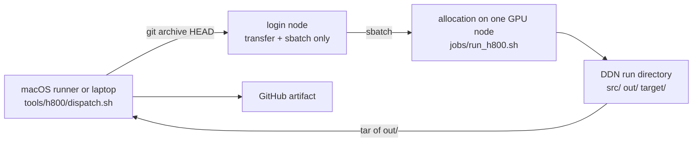

# H800 runs

`tools/h800/` runs this repository's GPU work on the H800 cluster and brings the
evidence back. It drives `.github/workflows/gpu-h800.yml`, and it works the same
way from a developer's shell.

The split exists because the CUDA contract has three tiers
([`src/backends/cuda/contract.md`](../../src/backends/cuda/contract.md)): Tier 1
(the contract check) and Tier 2 (the compile matrix) run on stock GitHub runners
in `.github/workflows/ci.yml`; Tier 3 needs a real card, and this cluster is
`sm_90a`.



## Commands

```bash
tools/h800/dispatch.sh --check    # read-only: SSH, Slurm, modules, free space
tools/h800/dispatch.sh --plan     # print what a run would do; touch nothing (default)
tools/h800/dispatch.sh --submit   # ship, submit, wait, fetch (explicit)
```

Settings come from `tools/h800/h800.env` (copy `h800.env.example`; the file is
git-ignored) or from the environment, which wins.

## What a run does

1. `dispatch.sh` packs the current commit with `git archive`, so uncommitted and
   untracked files are **not** shipped. A dirty checkout is refused instead of
   shipped quietly: commit first, or set `H800_ALLOW_DIRTY=1` to knowingly accept
   the commit alone. Before anything is submitted, the archive is checked to
   really contain the entry point.
2. It creates `$H800_ROOT/<utc>-<sha7>/` on the DDN, ships the source, the sbatch
   wrapper and a `run.env` into it, and submits exactly one job.
3. `jobs/run_h800.sh` runs inside the allocation and writes `out/`.
4. The dispatcher waits, fetches `out/` plus the Slurm logs (up to
   `H800_EVIDENCE_MAX_MB`, default 512), and exits with the job's own status.
   Giving up on the wait leaves the job running and exits 3: a missing `sacct`
   record is unknown, not failure, and never a reason to resubmit.

Run directories are unique and failures are kept on purpose: `H800_ROOT` grows by
one directory per run and never reuses a name.

Every submission writes `artifacts/h800/submit-receipts/<run-id>.json` with the
JobID, job name, remote directory and revision. That receipt is what the single
observer resumes from; resubmitting without reading it is how one run turns into
two chargeable jobs.

## Stages

| Stage | What it does | Needs a GPU |
| --- | --- | --- |
| `env` | Records the node, GPU, driver, CUDA, Python, Rust and revision the run actually saw | no (but reports what is attached) |
| `build` | Builds every declared backend with `src/backends/cuda/build_backends.py`, then lists the ELF images in each library | no |
| `tier3` | Prints what the Tier 3 contract declares today and executes nothing | no |
| `tests` | Runs the `#[ignore]` GPU tests named by `H800_TEST_ARGS` | yes |

`tier3` is deliberately a report. No backend in this tree declares
`status: validated` together with `reference.entrypoint`, and the contract does
not define how such an entrypoint is invoked or how its output is compared, so
the stage prints the declarations and says so instead of inventing a harness. It
fails only once a backend declares Tier 3 material that nothing here can run.

`tests` is opt-in because the GPU tests are gated by environment variables that
name real checkpoints, for example:

```bash
H800_TEST_ARGS='-p omni-jev --test cuda -- --ignored' \
H800_TEST_ENV=tools/h800/gpu-test.env \
tools/h800/dispatch.sh
```

`H800_TEST_ENV` points at a file of `KEY=value` lines. `{cuda_build}` in that
file is replaced by the build directory of the current run, so a test can load
the library it just built:

```text
OPEN_JEV_CUDA_LIB={cuda_build}/001-open-jev/libopen_jev.so
OPEN_JEV_MODEL=/aifs4su/shiheming/.../open-jev
```

## Requirements

* **Toolchain.** `H800_SHARED_TOOLS` points at a DDN toolchain with
  `cargo/`, `rustup/` and `bin/`. Its rustup has no default toolchain, so the job
  exports `RUSTUP_TOOLCHAIN=1.98.1`.
* **Python for the build stage.** `H800_PYTHON` must be able to run
  `build_backends.py`. Backends that need extra packages fail on their own and
  the run keeps the rest of the evidence; the `laya` backend additionally needs
  TileLang installed in that interpreter.
* **A runner.** Register a repo-scoped self-hosted runner with the labels
  `self-hosted`, `macOS`, `h800-dispatcher` and the SSH access to the login node.
  Repo scope matters: an organization-scoped runner would let upstream jobs run
  on this machine.

```bash
# on the machine that can reach the cluster
mkdir -p ~/actions-runners/system1-omni && cd ~/actions-runners/system1-omni
# token from the fork's Settings -> Actions -> Runners -> New runner
./config.sh --url https://github.com/<owner>/system1-omni --token <token> \
  --labels h800-dispatcher --name mac-h800-dispatcher --unattended
./svc.sh install && ./svc.sh start
```

## Rules this harness keeps

* The login node only transfers files and talks to the scheduler. Everything else
  runs in an allocation; `run_h800.sh` refuses to start on a login node.
* Nothing is written outside `$H800_ROOT`, and the job refuses a `RUN_DIR` that
  is not under `/aifs4su`.
* One submission per dispatch, no automatic retries, no automatic resource
  enlargement, no requeue: a failed run stays failed and its directory stays put.
* `umask 077` for every run directory.
* Runs land under the personal root only: `dispatch.sh` refuses an `H800_ROOT`
  that is not under `/aifs4su/shiheming/`, so two projects' ledgers stay apart.
* A timeout never cancels by itself: `H800_CANCEL_ON_TIMEOUT=1` is required to
  `scancel`, and the JobID stays in the receipt either way.
* Evidence is capped: an `out/` larger than `H800_EVIDENCE_MAX_MB` is not fetched
  (exit 4), so a cache or a model never rides back with the evidence.
* No secrets live in this repository. The runner holds the SSH access; the
  workflow only reads `vars.*` for cluster paths.
